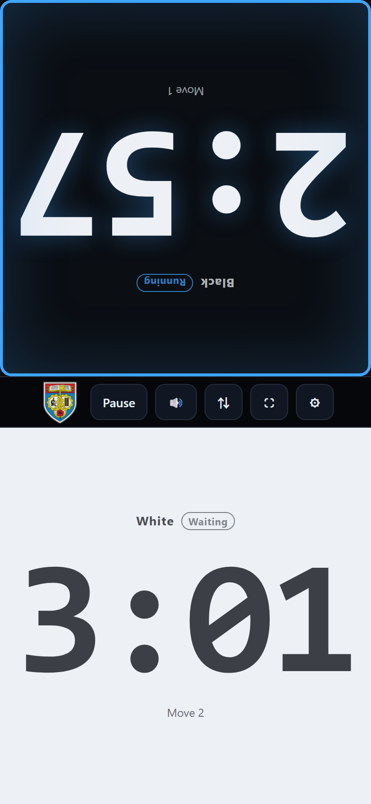
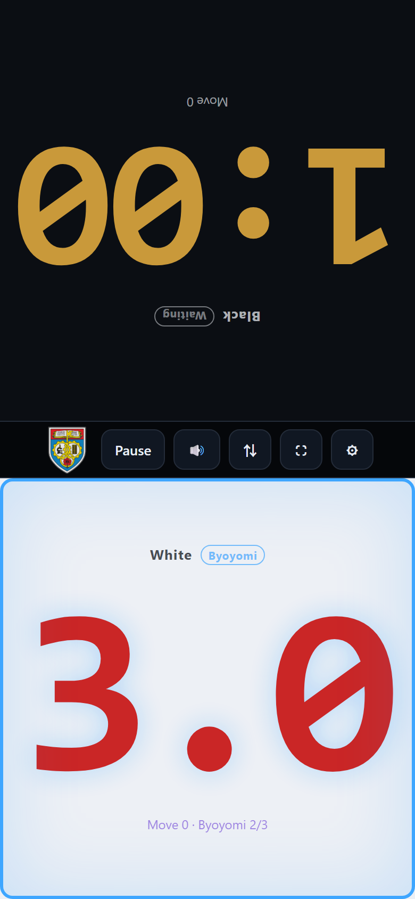
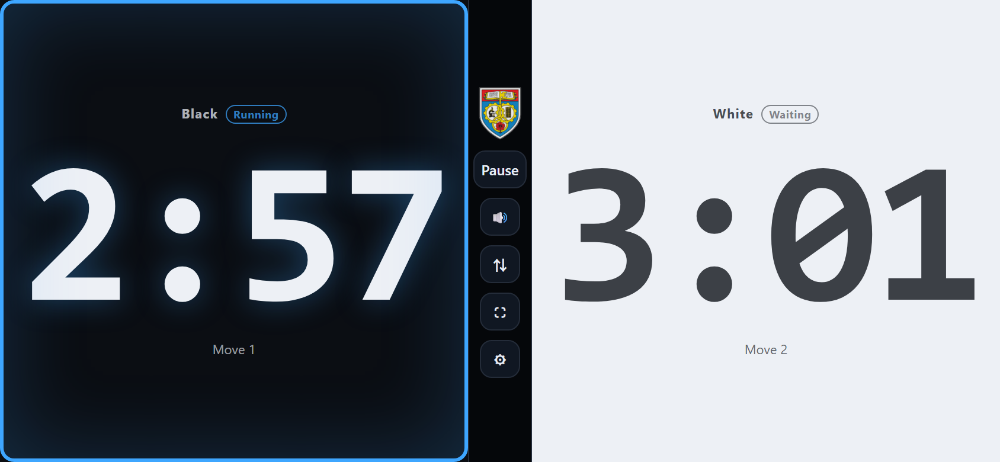

# CoQ Chess & Weiqi Clock

**English** · [华文](README_CN.md)

A web clock you can put on the table **at a community or school event right now**: plain HTML5 + vanilla
JavaScript, zero dependencies, no backend, **works offline**. It is **for both chess and Weiqi (Go)** — it suits
Go very well, since byoyomi *is* the standard Go time system, and the whole half-screen is a press button so
either player can just slap their own side. Open it in a phone browser and it is a tournament clock; double-click
`index.html` on a PC and it is an arbiter's desk clock.

The interface is **bilingual (English / Chinese)**: the `ENG / 华文` button at the top right of the setup page
switches it at any time and the choice is remembered (you can also force it with `index.html?lang=zh`).

> There is also a **Defold (Lua) port**: [`Defold/`](Defold/README.md) — the same product with the same timing
> semantics (the 8 constants and 30 test cases are cross-checked automatically), and it can be packaged as a
> native Windows / macOS / Linux / Android / iOS / HTML5 app. (Its README is in Chinese for now.)





> These are produced automatically by `tests/visual/`. **The screenshot scenes shorten the main time to 1 minute**
> so that the byoyomi phase shows up inside the virtual-time budget (the byoyomi part is still the default
> 20 s × 3 periods), so the digits differ from the 10+3×20 you get on first launch — that is expected.
> Also, `_scene-*.html` files are **throwaway test pages**: don't open them in your everyday browser (they stub
> `localStorage.setItem`, so they can't change your settings, but there is no reason to).

---

## 1. What a real chess clock offers, and what was kept

I went through tournament clocks (DGT 2010 / Chronos / Garde and friends) item by item and kept only what a game
actually uses:

| Real clock feature | This clock | Notes |
| --- | --- | --- |
| Games supported | Chess + Weiqi (Go) | Byoyomi is the Go system; see “Using it for Weiqi” in section 4 |
| Colour themes | Light / Medium / Dark | Dropdown on the setup page, remembered; see “Colour themes” in section 7 |
| Independent countdown per side, huge digits | ✅ | Digits grow to fill the panel so the far side of the table can read them |
| See-saw buttons: press one side, stop it and start the other | ✅ | **The whole half-screen is the button** — slap it with your palm, no aiming. This is also how the game starts: there is **no Start button** |
| Move-order logic (pressing your own side before moving does nothing) | ✅ | Same as a real clock: pressing the inactive side has no effect |
| Fischer increment (added after each move) | ✅ | Most common in tournaments; shares one preset list with Bronstein and sudden death |
| Byoyomi (fresh X seconds per move once the main time is gone, multi-period) | ✅ | **The default mode on first launch**; the Go / Shogi / Xiangqi system, see section 4 |
| Bronstein delay (first N seconds of each move are free) | ✅ | Good for beginners — no panic time loss |
| Sudden death (no increment) | ✅ | The simplest mode, common in community events |
| Flag fall (time-up handling) | ✅ | Red digits + alarm + vibration + result overlay |
| Time warnings | ✅ | Amber at ≤1 minute, red with 0.1 s resolution at ≤20 seconds |
| Byoyomi indicator | ✅ | Digits turn purple, remaining periods shown, ticks every second for the last 10 |
| Move counter | ✅ | Each panel shows how many moves that side has played |
| Pause / resume (for the arbiter taking notation or settling a dispute) | ✅ | Pausing banks the exact time (and byoyomi periods) used on the current move |
| Reset / rematch (swapping colours) | ✅ | One tap starts the next game |
| Sound switch | ✅ | Move beep + time-up alarm (synthesised live, no audio files) |
| Two-sided facing layout (both players read their own side) | ✅ | “Facing mode”, see section 5 |
| Keep screen awake | ✅ | Wake Lock API, the screen stays on during a game |
| Replaceable logo / favicon | ✅ | Overwrite `assets/logo-source.png`, run `node tools/export-icons.js`, see section 7 |
| Battery indicator | ❌ | The phone has one; no need to duplicate it |
| Multiple time controls (e.g. 40 moves/90 min + 30 min) | ❌ | Single period only; byoyomi “periods” are a different thing. See section 8 |
| Automatic checkmate / draw detection | ❌ | A clock cannot see the position; the arbiter declares time-out results, see section 6 |

---

## 2. Running it

### Option 1 — phone as the clock (recommended, this is what you use at the event)

On the PC:

```bash
node serve.js            # port 8080 by default; or PORT=8081 node serve.js
```

The terminal prints addresses your phone can reach, for example:

```
棋钟已启动（同一 Wi-Fi 下的手机可直接访问）：
Clock is running — open it on a phone on the same Wi-Fi:
  本机 / local:  http://localhost:8080/
  手机 / phone:  http://192.168.1.23:8080/
按 Ctrl+C 停止 / press Ctrl+C to stop.
```

Connect the phone to the same Wi-Fi and open that `192.168.x.x` address in its browser.
(If the phone cannot open it, Windows Firewall is usually blocking Node — the first run pops up a dialog, choose
“allow on private networks”.)

### Option 2 — local use on a PC

Just double-click `index.html`. Everything works (including facing rotation, sound and fullscreen) with no server
at all.

### Option 3 — host it online (players open it on their own phones)

The whole folder is static: drop it on any static host, **no backend, no database**:

* GitHub Pages: push this folder to a repo, Settings → Pages → pick the branch root
* Netlify Drop: drag the folder onto <https://app.netlify.com/drop>
* Vercel / Cloudflare Pages: same idea

### Two things worth doing (strongly recommended)

1. **Add to home screen**: phone browser menu → “Add to Home Screen”. No address bar, nearly fullscreen, and it
   opens offline (the files are cached locally).
2. **Turn on airplane mode or do-not-disturb**: an incoming call interrupts the clock (see section 6).

---

## 3. Using it

### Game flow

1. On the setup page pick the **timing mode** and the **time control** (a preset is fine), then tap “Start game”.
2. On the clock screen **there is no Start button** — the panels *are* the see-saw. Tapping one side stops that
   side's clock and starts the other side's, so to begin a game (White to move first) **tap Black's half**:
   White's clock starts counting down at once. Tapping White's half instead starts Black's clock, in case Black
   is to move first. That first tap is not counted as a move.
3. Whoever has moved **slaps their own half of the screen**; the time immediately passes to the opponent.
4. When a side reaches zero: the clock stops at once, the alarm sounds, the phone vibrates and a result overlay
   appears (“… ran out of time / … wins”).
   → “Rematch (swap colours)” or “Back to setup”.
5. To stop the clock temporarily (notation, settling a dispute): tap “Pause”, then “Resume”. That button only
   appears once the clock is running.

### The middle toolbar

| Button | What it does |
| --- | --- |
| Pause / Resume | Only shown while a game is running; **no Start button** — the clock is started by tapping a panel |
| 🔊 / 🔇 | Sound switch (move beep + time-up alarm) |
| ⇅ | Facing mode (see section 5) |
| ⛶ | Fullscreen (iOS Safari has no web fullscreen — use “Add to Home Screen” instead) |
| ⚙ | Back to setup (asks for confirmation during a game) |

### Keyboard, when a PC is the clock

| Key | What it does |
| --- | --- |
| `A` / `←` | White's button (pressing it starts Black's clock before the game begins) |
| `L` / `→` | Black's button (pressing it starts White's clock before the game begins) |
| `Space` | Pause / resume (does nothing before the first panel press) |
| `F` | Fullscreen |

---

## 4. Timing modes and recommended settings

| Mode | Rule | When to use it |
| --- | --- | --- |
| **Fischer increment** (recommended) | A fixed number of seconds is added to your own clock after each move | The current FIDE standard. 10+5 and 15+10 are the usual choices |
| **Bronstein delay** | The first N seconds of each move are not counted; the clock starts after that | Beginners and junior events: no time lost to panic in the first seconds |
| **Byoyomi** | Once the main time is gone, **each move gets a fresh X seconds** (unused time does not carry over); with N periods, one overstep consumes a period and going over again after the last one loses | The Go / Shogi / Xiangqi system; also good for “a limit per move in the final phase” |
| **Sudden death** | Main time only | The simplest sudden-death control |

**How byoyomi actually works** (example: 60 minutes + 30 seconds × 3 periods):

1. Think freely inside the 60 minutes of main time; modes that add time from move 1 are Fischer — byoyomi does
   **not** apply early.
2. Main time exhausted → byoyomi starts: every move gets a full 30 seconds. Using 12 seconds on this move is
   safe, and **the next move still gets a full 30 seconds** (nothing accumulates or carries over).
3. If a move goes past 30 seconds → one period is consumed, the count resets to 30 seconds and you carry on
   thinking; “30 s × 3 periods” means **you may overthink twice**, and the third overstep loses.
4. On screen: during byoyomi the digits turn **purple** and show “Byoyomi 2/3”; the amber main-time warning does
   not appear in this phase, but the last 20 seconds still turn red, and the last 10 seconds tick every second.

> Byoyomi and Bronstein delay are the pair people mix up: Bronstein hands you N seconds on **every move from move
> 1**; byoyomi is **the monthly salary that starts only after your savings are gone**.

Built-in presets (you can always type your own: 1–180 minutes / 0–180 byoyomi seconds / 1–20 periods) —
**the presets follow the mode**:

**Chess-style modes** (Fischer / Bronstein / sudden death):

| Preset | Class | Typical use |
| --- | --- | --- |
| 1+0 | Bullet | Casual rapid events |
| 3+2 | Blitz | FIDE blitz standard |
| 5+0 / 5+3 | Rapid | School rapid events |
| **10+5** | Rapid | **Recommended for community / school events** |
| 15+10 | Rapid | FIDE rapid standard, comfortable |
| 25+10 / 30+0 | Classical | Club league |
| 60+30 | Classical | The classic byoyomi-style chess control (60 min + 30 s per move) |
| 90+30 | Classical | A good approximation of a single-period classical control |

**Weiqi (Byoyomi) mode** — the notation is “**main time + periods × seconds per move**”, so `10+3×20` means
10 minutes of main time, then 20 seconds per move for 3 periods (you may overthink twice and lose on the third):

| Preset | Read as | Typical use |
| --- | --- | --- |
| 5+3×20 | 5 min + 20 s × 3 periods | Junior / fast Go events |
| **10+3×20** | 10 min + 20 s × 3 periods | **The default** (this is what you get on first launch) |
| 10+3×30 | 10 min + 30 s × 3 periods | School Go events |
| 15+3×30 | 15 min + 30 s × 3 periods | School / community events |
| 20+5×30 | 20 min + 30 s × 5 periods | Standard amateur events |
| 30+5×30 | 30 min + 30 s × 5 periods | Club events |
| 30+3×60 | 30 min + 60 s × 3 periods | Slow games |
| 60+5×60 | 60 min + 60 s × 5 periods | Formal slow games |

> The small line under each button (e.g. `20s × 3`) spells the order out: it is the same thing as the main
> notation `3×20`.
> For community and school events I suggest **10+3×20** (the default) or **15+3×30**: beginners won't lose time
> just because they couldn't find the button.

### Using it for Weiqi (Go)

This clock is **not only for chess** — it works for Go as-is, because the Go system *is* “main time + byoyomi”,
which is exactly this clock's Byoyomi mode, and **that is what you get on first launch** (English + Byoyomi +
`10+3×20`).

| Common Go control | How to set it here |
| --- | --- |
| 10 min main time, then 20 s × 3 per move | Pick the preset **10+3×20** (the default, ready to go) |
| 30 min main time, then 30 s × 5 per move | Pick the preset **30+5×30** |
| 1 hour main time, then 60 s × 5 per move | Pick the preset **60+5×60** |
| 40 min main time, then 30 s × 3 per move | There is no 40-minute preset: choose **Byoyomi** and change the three numbers to 40 / 30 / 3 |
| Absolute time only (flag falls, you lose) | Choose **Sudden death**, or set the byoyomi periods to 1 |

The preset buttons use “main time + periods × seconds per move”: `30+5×30` is 30 minutes of main time, then
30 seconds per move for 5 periods (you may overthink 4 times and lose on the fifth); the small `30s × 5` line is
the same thing written in the other order.

During the game it works like chess: lay the phone flat between the two players, turn on **facing mode**, and
whoever has just played slaps their own half of the screen. To start, tap **Black's** half so White's clock runs
first (see the game flow in section 3). The digits fill the panel automatically so they are readable from across
the table. The usual Go “30 seconds per move” byoyomi ticks audibly for the last 10 seconds.

---

## 5. Placement (facing mode)

Lay the phone flat between the two players, screen up:

```
        Black player (opposite side)
   ┌──────────────────┐
   │   ███ Black 2:57  │  ← the top panel is rotated 180°, upright for the far side
   ├──────────────────┤
   │  ▣ Pause 🔊 ⇅ ⛶ ⚙ │  ← toolbar: logo on the left, reachable from both sides
   ├──────────────────┤
   │   White 3:01 ███  │  ← the bottom panel is not rotated, upright for the near side
   └──────────────────┘
        White player (near side)
```

* **Portrait (recommended)**: split top/bottom — Black on top, White below. With facing mode on, **the top panel
  is rotated 180°** so the far player reads their own digits upright. If the phone stands up for an arbiter or
  spectators, turn facing mode off and both sides read normally.
* **Landscape**: split left/right (Black left, White right) and **never rotated**. In landscape both panels sit on
  the same line of sight, so no single-panel rotation can make both players read upright — landscape is better for
  propping the phone up or for the arbiter and spectators.

The clock is started from the panels themselves: tap the far side's half (Black, when White is to move first) and
the other side's clock begins. There is no Start button to press.

---

## 6. Arbiter notes and known limits (important — read first)

1. **Where a time-out ruling ends**: this clock only does “time ran out → stop the clock → tell you”. It **does
   not judge the position**. Under FIDE rule 6.9, if the opponent of the player who flagged “cannot checkmate by
   any possible series of legal moves” (king vs king, king and knight, king and bishop), the game is **drawn**,
   not lost. The overlay says “time out / wins”; the arbiter makes the final ruling based on the position.
2. **One device per game**: there is **no** time synchronisation between browser pages. Use one device per game.
3. **Background/screen-off timing stays correct**: when the phone screen turns off or the tab is backgrounded, the
   browser throttles or freezes timers. All display and flag decisions here are derived from **absolute
   timestamps** (“banked time − the moment this move started”), so coming back to the foreground immediately gives
   the right numbers and the right side to flag — at worst a time-out is noticed a second late, never added or
   lost. This is covered by unit tests.
4. **Calls, notifications, accidental taps**: at an event, turn on airplane mode or do-not-disturb and switch off
   popup notifications; refreshing or closing the page during a game asks for confirmation. On accidental taps:
   the whole panel is the button, so put the phone down firmly (not on the edge of the board), and note that
   pressing the side that is not to move has no effect at all (implemented that way).
5. **Battery and brightness**: bring a power bank and turn the brightness up (outdoors). The clock requests a wake
   lock during a game, but iOS below 16.4 and some browsers do not support it — in that case set auto-lock to
   “Never” manually.
6. **Browser requirements**: iOS 13+ / Android Chrome 55+ (Pointer Events needed). Desktop Chrome / Edge /
   Firefox / Safari all work.
7. **Privacy**: no network access, nothing uploaded; settings (mode/time/sound) live only in your own
   `localStorage`.
8. **What loses in byoyomi mode**: **exhausting the byoyomi periods**, not the main time reaching zero. The move
   line on the panel shows “Byoyomi 2/3”; watch out when only the last period is left. Pausing banks the periods
   already crossed, and on resume the current byoyomi window is refilled (so nobody loses byoyomi time to a
   pause).
9. **Starting the game**: there is no Start button — tapping a panel *is* the start gesture (tap Black's half for
   White to move first). Agree before the round on who taps, and note that the first tap does **not** count as a
   move, so the move counters still read 0/0.

---

## 7. Directory layout and tests

```
ChessClock/
├── index.html            page structure (the only entry point)
├── README.md             this file (English, default)
├── README_CN.md          the same document in Chinese
├── styles.css            styling: portrait split / landscape split / facing rotation / byoyomi colours + the three theme variable blocks
├── engine.js             timing engine: pure logic, no DOM, time injected from outside → unit-testable
├── i18n.js               ★ the bilingual string table (zh / en) + language resolution; all UI copy lives here
├── app.js                UI and input layer: rendering, touch/keyboard, sound, wake lock, local storage, language switch
├── assets/
│   ├── logo-source.png   ★ the master logo (currently the TARUMT shield, 447×447 with alpha)
│   ├── logo-brand.png    setup-page logo, 288×288 (displayed at 96×96)
│   ├── logo-strip.png    toolbar logo, 144×144 (displayed at 48×48)
│   ├── icon-32.png       favicon
│   ├── icon-64.png       favicon (high DPI)
│   ├── icon-180.png      iOS “Add to Home Screen” icon
│   ├── logo.svg          the old CoQ vector art (unused, kept as a backup)
│   └── README.md         how to swap the icon + the “logo missing on phones” pitfall
├── tools/
│   └── export-icons.js   derives all those PNGs from logo-source.png
├── serve.js              zero-dependency static server (for phones on the LAN)
├── tests/
│   ├── engine.test.js    timing engine tests (30)
│   ├── project.test.js   project-integrity tests (17: i18n / themes / defaults / presets / scenes / start-up / icons …)
│   ├── run.js            single-process test entry point
│   └── visual/           headless-Chrome visual rig (screenshots) + out/*.png artefacts
├── Defold/               the Defold (Lua) port: native apps and HTML5, see Defold/README.md
└── package.json          npm test / npm start / npm run shots
```

```bash
npm test        # 47 tests: timing logic + page/icon/bilingual/theme/defaults/screenshot-scene integrity
npm start       # start the LAN server, open it on your phone
npm run shots   # re-shoot every scene with headless Chrome (needs Chrome/Edge installed)
```

The screenshot script can also pick scenes, pixel density and language (handy after a styling or copy change, so
you don't have to run every scene):

```powershell
powershell -ExecutionPolicy Bypass -File tests/visual/shoot.ps1 -Only 'setup,midgame-portrait'          # just these two (phone 2×)
powershell -ExecutionPolicy Bypass -File tests/visual/shoot.ps1 -Only 'setup' -Scale 1                  # PC density (1×)
powershell -ExecutionPolicy Bypass -File tests/visual/shoot.ps1 -Only 'setup' -Lang zh                  # Chinese UI → out/setup-zh.png
powershell -ExecutionPolicy Bypass -File tests/visual/shoot.ps1 -Only 'setup' -Theme light              # light theme → out/setup-light.png
```

The tests cover the places that **break easily**: the increment applies from move 1, delay only forgives N
seconds, each byoyomi move refills the window, multi-period byoyomi (“5 periods = 4 oversteps allowed, the fifth
loses”), a move played during byoyomi consumes a period, the hand-off when the main time runs out mid-move,
pressing the inactive side does nothing, duplicate delivery of one touch is debounced, pausing banks time and
periods first, pressing the clock after a flag cannot “rescue” time, a page suspended for 30 minutes still flags
the correct side, time formatting (hours / minutes / 0.1 s), the logo master and both PNG pixel sizes, identical
key sets across both languages with every used key present, and no hard-coded copy left in `app.js`. It also pins
the start-up rule: **there is no Start button**, the first panel tap starts the *other* side's clock
(tap Black → White runs), and that tap does not count as a move.

### Bilingual UI (English / 华文)

The setup page has an **`ENG / 华文`** button at the top right; one tap switches the whole interface and the half
for the active language lights up. The choice is stored in `localStorage` (the `lang` field of
`chessclock.settings.v1`), so the next visit keeps it.

* With no saved settings the default is **English (ENG)** — tap `ENG / 华文` once for Chinese and it is remembered;
* To force a language for a link: `index.html?lang=en` or `?lang=zh` (the URL wins over the saved setting, which
  makes sharing a Chinese link easy);
* All copy lives in the `DICT` table of **[i18n.js](i18n.js)**. To add a third language, add one entry to `DICT`
  and one to `LANGS`, plus a `data-lang-name="xx"` name in the `index.html` language button — no other code
  changes;
* When adding copy: static page text uses `data-i18n="key"` (use `data-i18n-html` when it contains HTML, and
  `data-i18n-title/aria-label/alt/placeholder` for attributes and placeholders); in JS always use
  `t('key', {vars})`. The tests check that both languages have identical key sets, that every used key exists,
  that placeholders match, and that no hard-coded Chinese is left in `app.js`;
* To see both languages rendered: `shoot.ps1 -Only 'setup' -Lang en` (English) and `-Lang zh` (Chinese), producing
  `out/setup-en.png` and `out/setup-zh.png`.

### Colour themes (Light / Medium / Dark)

The “3. Options” card on the setup page has a **Colour theme** dropdown with three choices: Light / Medium
(slate) / Dark (the default). The choice is stored in `localStorage` too and can be forced with
`index.html?theme=light` (or `medium` / `dark`).

Implementation: a theme is just a set of CSS variables. The top of `styles.css` has three blocks:

```css
:root, :root[data-theme="dark"] { --bg: …; --fg: …; --card: …; --accent: … }
:root[data-theme="medium"] { … }
:root[data-theme="light"]  { … }
```

Switching does exactly one thing in `app.js`: it puts `data-theme="…"` on `<html>` (and points the mobile
browser's `theme-color` at the current `--bg`). **The two game panels always stay “Black dark, White light”** —
that is game semantics, not decoration; in the light theme the White panel automatically gets a hairline
`--pane-edge` so it does not blend into the page background.

* To tweak a theme, edit only its variable block (`--card` is the card surface, `--sunken` a recessed well,
  `--btn` a button surface);
* To add a fourth theme: one variable block in `styles.css` + one entry in `THEMES` in `app.js` + one
  `<option value="…">` in `index.html` + the strings in `i18n.js` (a test checks those four places agree);
* No flash on load: a small inline script in `<head>` applies the saved theme to `<html>` before the first paint
  (otherwise a light-theme user would see a dark flash on every visit).

### Restoring the factory defaults

The defaults (English / Byoyomi / 10+3×20 / Dark) only apply to a browser that has **never saved settings**. If
your browser has an older save, run this once in the developer console:

```js
localStorage.removeItem('chessclock.settings.v1'); location.reload();
```

> Avoid opening `tests/visual/_scene-*.html` (generated in the project root, named `_scene-*.html`) in your
> everyday browser: they drive the UI through real interactions, which goes through `saveSettings()`. The script
> stubs `localStorage.setItem`, but it is simpler to only run them via `npm run shots`.

### Swapping the logo / icons

There is exactly one master: **`assets/logo-source.png`** (currently the TARUMT shield, 447×447 with alpha).
The page references derived files, and **each use has exactly one file**:

| PNG | Used for | File pixels | Displayed at |
| --- | --- | --- | --- |
| `logo-brand.png` | setup-page logo | 288×288 | 96×96 |
| `logo-strip.png` | toolbar logo | 144×144 | 48×48 |
| `icon-32/64/180.png` | favicon / iOS home screen | 32 / 64 / 180 | — |

Overwrite `logo-source.png` with your artwork and re-run this once to refresh all of them (headless Chrome, no
dependencies to install):

```bash
node tools/export-icons.js
```

> ⚠️ **`srcset` is deliberately not used.** When it was written as
> `src="…-96.png 1x, …-96@2x.png 2x"`, phones (pixel ratio ≥2) only ever fetched the `2x` file, so replacing only
> the `1x` copy produced the “**fine on PC, logo missing on the phone**” bug.
> Now each use exports exactly one file at **3× the displayed size**: sharp on phones, downscaled by the browser
> on PCs, and swapping artwork means replacing a single file.

To change a displayed size, edit `width/height` for `.brand-logo` / `.strip-logo` in `styles.css`, the matching
`width`/`height` in `index.html`, and the `JOBS` sizes in the script — the tests check all of them together.

(`logo.svg` is the old CoQ vector art, kept only as a backup. Details in [assets/README.md](assets/README.md).)

---

## 8. Possible extensions (deliberately not done this round)

* Multi-stage controls (e.g. 40 moves / 90 minutes + 30 minutes + 30 s per move) — needs a “stage” concept in the
  engine and an extra field in the UI.
* Two-phone sync (WebRTC / WebSocket) so each player watches their own phone.
* Position input (FEN) for automatic draw detection: when a player flags and the opponent has only a knight or
  bishop left, rule it a draw under FIDE 6.9 automatically.
* PWA offline cache + manifest so an installed home-screen app works fully offline.
* Recording each move's time (useful for reviewing time management).

## Licence

MIT. Use it freely for community events, school events and club activities.
